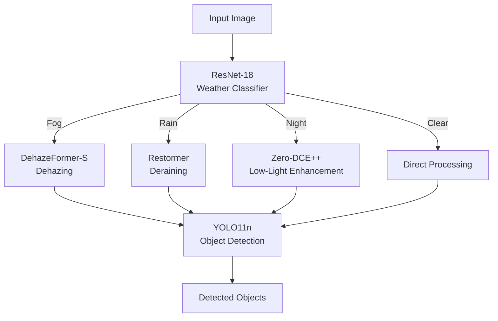

# Adaptive Weather-Aware Object Detection

## 1. Project Overview
Conventional object detection systems suffer under adverse weather and illumination conditions because the visual domain differs significantly from the conditions represented during detector training. Adverse weather induces high rates of false positives and false negatives, posing extreme safety risks.

This project proposes a Mixture-of-Experts (MoE) inspired architecture:

1. **Weather Classification:** A ResNet-18 model identifies the environmental condition.
2. **Adaptive Expert Selection:** The system dynamically routes the image to a specialized image restoration network.
3. **Weather-Specific Enhancement:** The image is restored using state-of-the-art Vision Transformers or CNNs.
4. **Object Detection:** The standardized, cleaned image is processed by YOLO11n for real-time vehicle and pedestrian detection.

## 2. Motivation
Autonomous systems must handle domain shifts caused by degraded visibility, low illumination, fog scattering, and rain degradation. While some literature suggests uniformly applying image restoration before detection, these "distributed methods" can sometimes optimize for human perception and remove high-frequency semantic textures needed by object detectors. To prevent this, our pipeline selectively applies localized, weather-specific enhancements *only* when the corresponding condition is detected, bypassing enhancement entirely on clear days to preserve textures and reduce computational latency.

## 3. System Architecture



## 4. Mixture of Experts (MoE) Routing

Rather than using a single image-enhancement model for every condition, the system uses a **Mixture of Experts (MoE)** architecture. A weather classifier determines the current degradation domain and routes the image to a specialized enhancement network.

| Weather Condition | Expert Model | Action |
|---|---|---|
| Fog | DehazeFormer-S | Dehazing |
| Rain | Restormer | Rain-streak removal |
| Night | Zero-DCE++ | Low-light enhancement |
| Clear | None | Enhancement bypassed |

The routing strategy avoids unnecessary enhancement for clear images and allows each restoration model to specialize in its target degradation.

---

## 5. Weather Classification

The first stage of the pipeline classifies the input image according to its dominant weather/illumination condition.

- **Architecture:** ResNet-18
- **Training:** Transfer learning
- **Classes:** Clear, Fog, Rain, Night
- **Test Accuracy:** >91% on the unseen test dataset

The classifier acts as the **routing network** of the Mixture-of-Experts system.

---

## 6. Dataset

The project uses a custom, balanced dataset containing approximately **16,000 images** for weather-aware computer vision experiments.

The dataset was constructed from the following public datasets:

- **BDD100K:** Clear and Rain images
- **RTTS:** Fog images
- **ExDark:** Night/Low-light images

### Dataset Split

- **Training:** 70%
- **Validation:** 15%
- **Testing:** 15%

> **Note:** The complete dataset is not included in this repository due to dataset size and the licensing requirements of the original datasets. Users must obtain the original datasets from their respective sources and construct the required directory structure.

---

## 7. Weather Enhancement Experts

### 7.1 Fog — DehazeFormer-S

**Purpose:** Removal of atmospheric haze and fog.

**Architecture:** DehazeFormer-S is a Transformer-based image restoration model designed specifically for image dehazing.

**Integration Details:**

- Outdoor pretrained weights are used.
- OpenCV BGR images are converted to RGB.
- Pixel values are normalized to `[0, 1]`.
- Input images are dynamically padded to dimensions compatible with the Transformer architecture.
- Padding is removed after inference to restore the original image resolution.
- The output is converted back to OpenCV BGR format.

This allows the model to process arbitrary camera resolutions without requiring the input image to have a fixed size.

---

### 7.2 Rain — Restormer

**Purpose:** Removal of rain streaks and rain-related image degradation.

**Architecture:** Restormer is a Transformer-based image restoration architecture that uses **Multi-Dconv Head Transposed Attention (MDTA)** and multi-scale feature processing.

**Integration Details:**

The official pretrained checkpoint was inspected and the restoration architecture was aligned with the checkpoint's `state_dict` structure.

One important compatibility issue involved the deep bottleneck:

```text
Official checkpoint:
latent.*

Initial architecture:
encoder_level4.*
```

The architecture was modified so that the parameter names matched the official checkpoint.

This demonstrates an important practical issue when integrating research checkpoints: the architecture implementation and checkpoint must be structurally compatible before pretrained weights can be loaded.

---

### 7.3 Night — Zero-DCE++

**Purpose:** Enhancement of low-light images.

**Architecture:** Zero-DCE++ uses a lightweight convolutional architecture based on depthwise-separable convolutions to estimate pixel-wise enhancement curves.

**Integration Details:**

- The official Zero-DCE++ checkpoint was inspected and verified before integration.
- The checkpoint contains 28 parameter tensors, corresponding to the seven convolutional stages and their depthwise/pointwise components.
- A key architecture mismatch was identified in the final layer:

```text
Checkpoint output:
3 channels

Initial implementation:
24 channels
```

The final pointwise convolution was corrected to produce 3 output channels, corresponding to the RGB enhancement curves required by the pretrained model. After the correction, the architecture is compatible with the official checkpoint.

---

## 8. Object Detection

The final stage of the system performs object detection on the enhanced image.

- **Model:** YOLO11n (Nano)
- **Framework:** Ultralytics
- **Purpose:** Real-time object detection
- **Input:** Original image or weather-enhanced image
- **Output:** Bounding boxes, class labels, and confidence scores

YOLO11n was selected because of its lightweight architecture and suitability for real-time inference. The detector operates after the weather-specific enhancement stage:

```text
Input Image
    ↓
Weather Classification
    ↓
Weather-Specific Enhancement
    ↓
YOLO11n
    ↓
Object Detections
```

---

## 9. End-to-End Pipeline

The complete adaptive pipeline operates as follows:

1. **Input Image** — An image is captured or loaded using OpenCV.
2. **Weather Classification** — ResNet-18 predicts the weather/illumination condition.
3. **Expert Routing** — The classifier routes the image to the appropriate restoration model.
4. **Image Enhancement:**
   - Fog → DehazeFormer-S
   - Rain → Restormer
   - Night → Zero-DCE++
   - Clear → Enhancement bypassed
5. **Image Reconstruction** — The enhanced image is converted back to its original spatial resolution and OpenCV BGR representation.
6. **Object Detection** — YOLO11n performs object detection.
7. **Final Output** — Bounding boxes, class labels, confidence scores, and the enhanced image are produced.

---

## 10. Results

Qualitative results generated during development are stored in the `results/` directory.

```text
results/
├── fog/
│   └── fog_result.jpg
├── rain/
│   └── rain_result.jpg
└── night/
    └── night_result.jpg
```

**Fog Processing** — The DehazeFormer-S outdoor pretrained model was integrated into the pipeline for foggy outdoor scenes. The resulting images showed improved visibility in foggy regions and enabled downstream object detection on the processed image.

**Night Processing** — Zero-DCE++ was integrated for low-light enhancement. The enhancement improves scene visibility while preserving the existing structure of illuminated regions.

**Rain Processing** — Restormer was integrated for rain-streak removal. The resulting enhanced image is passed to YOLO11n for downstream object detection.

> **Important:** Qualitative improvement does not necessarily imply improved object-detection accuracy. Quantitative detection evaluation is required to establish the actual benefit of the enhancement models.

---

## 11. Quantitative Evaluation

| Metric | Result |
|---|---|
| Weather Classifier Test Accuracy | >91% |
| Pipeline Detection mAP | Pending |
| Pipeline Latency / FPS | Pending |

The current project has successfully validated the individual components and their integration. Full end-to-end quantitative evaluation remains future work.

The most important next evaluation is to compare:

```text
Original Image → YOLO11n
            vs.
Weather-Aware Enhancement → YOLO11n
```

using the same test images and detection metrics.

---

## 12. Installation

### Requirements

Recommended environment:

- Windows
- Python 3.10
- NVIDIA GPU
- CUDA-compatible PyTorch installation

Create the Conda environment:

```bash
conda create -n weather_cv python=3.10
conda activate weather_cv
```

Install the project dependencies:

```bash
pip install -r requirements.txt
```

> CUDA/PyTorch compatibility depends on the installed NVIDIA driver and PyTorch build. Verify your CUDA-enabled PyTorch installation before running GPU inference.

---

## 13. Model Weights

The pretrained model weights are not included in this repository. Download the appropriate pretrained checkpoints from their original sources and place them in the following structure:

```text
models/
├── weather_classifier_resnet18.pth
└── pretrained_enhancers/
    ├── dehazeformer-s.pth
    ├── restormer_deraining.pth
    └── zerodce_pp.pth
```

### Model Sources

| Model | Source |
|---|---|
| DehazeFormer-S | [IDKiro/DehazeFormer](https://github.com/IDKiro/DehazeFormer) |
| Restormer | [swz30/Restormer](https://github.com/swz30/Restormer) |
| Zero-DCE++ | [Li-Chongyi/Zero-DCE_extension](https://github.com/Li-Chongyi/Zero-DCE_extension) |
| YOLO11 | [ultralytics/ultralytics](https://github.com/ultralytics/ultralytics) |

> **Important:** Model weights are subject to the licenses and terms of their respective authors/projects. Check the original repositories before redistributing or using pretrained weights commercially.

---

## 14. Running the Project

### Test Individual Enhancement Modules

```bash
# Fog
python src/enhance_fog.py

# Rain
python src/enhance_rain.py

# Night
python src/enhance_night.py
```

### Run the Complete Pipeline

```bash
python src/pipeline.py
```

The master pipeline performs:

```text
Input
    ↓
Weather Classification
    ↓
Expert Selection
    ↓
Image Enhancement
    ↓
YOLO11n
    ↓
Detection Output
```

---

## 15. Project Structure

```text
weather_aware_detection/
│
├── src/
│   ├── config.py
│   ├── pipeline.py
│   ├── detector.py
│   ├── enhance_fog.py
│   ├── enhance_rain.py
│   ├── enhance_night.py
│   ├── model.py
│   │
│   └── models_arch/
│       ├── dehazeformer.py
│       ├── restormer.py
│       └── zerodce.py
│
├── models/
│   └── pretrained_enhancers/
│       └── .gitkeep
│
├── results/
│   ├── fog/
│   ├── rain/
│   └── night/
│
├── requirements.txt
├── README.md
└── .gitignore
```

### Files intentionally excluded from Git

```text
datasets/
*.pth
*.pt
*.onnx
__pycache__/
.env
```

Large datasets and pretrained model checkpoints should remain outside the Git repository unless their licenses explicitly permit redistribution.

---

## 16. Technical Concepts

### Domain Shift

Domain shift occurs when the distribution of the data encountered during inference differs from the distribution used during model training. For example, an object detector trained primarily on clear images may experience reduced performance when deployed on:

- Foggy images
- Rainy images
- Night-time images
- Low-contrast scenes

The proposed system attempts to reduce this degradation by restoring the input image before object detection.

### Mixture of Experts

The project uses a Mixture of Experts (MoE) concept. Instead of forcing one restoration model to handle every type of degradation, the system selects a specialized expert according to the predicted weather condition.

```text
                 ┌── Fog   ──→ DehazeFormer-S ──┐
                 │                              │
Input → ResNet18 ├── Rain  ──→ Restormer ───────┤
                 │                              ├──→ YOLO11n
                 ├── Night ──→ Zero-DCE++ ───────┤
                 │                              │
                 └── Clear ──→ Bypass ──────────┘
```

This provides a conditional restoration strategy rather than a single universal enhancement network.

### State Dictionaries

PyTorch models store learned parameters in a `state_dict`. A checkpoint may contain keys such as:

```text
encoder_level1.0.attn.qkv.weight
latent.0.norm1.body.weight
e_conv7.point_conv.weight
```

The architecture used during inference must expose compatible parameter names and tensor shapes. Checkpoint integration therefore requires verification of:

- Parameter names
- Tensor shapes
- Number of layers
- Architecture structure

---

## 17. Challenges and Engineering Lessons

### 17.1 Architecture–Checkpoint Mismatches

Research repositories often contain training frameworks or architecture implementations that differ from the simplified architecture used in a deployment project. During integration, checkpoint mismatches were encountered in both Restormer and Zero-DCE++.

For Restormer, the checkpoint used `latent.*` while the initial implementation expected `encoder_level4.*`. The architecture was aligned with the checkpoint structure.

For Zero-DCE++, the checkpoint expected `e_conv7.point_conv` to output 3 channels, while the initial implementation produced 24 channels. The final layer was corrected to match the pretrained checkpoint.

### 17.2 Transformer Input Constraints

Transformer-based restoration networks can impose spatial-size constraints. To support arbitrary camera resolutions, the fog enhancement module dynamically pads the input:

```text
Original Image
    ↓
Calculate Required Padding
    ↓
Pad to Compatible Resolution
    ↓
Transformer Inference
    ↓
Crop Padding
    ↓
Original Resolution
```

This prevents inference failures caused by incompatible input dimensions.

### 17.3 Domain-Specific Pretrained Models

A major practical lesson was that pretrained weights must match the target deployment domain. For example, outdoor dehazing weights were preferred for natural outdoor driving scenes rather than blindly using a different dehazing checkpoint. This highlights the importance of considering domain shift not only in object detection, but also in image restoration.

---

## 18. Limitations

- **Classification Errors** — If the weather classifier predicts the wrong condition, the image may be routed to an unsuitable enhancement expert.
- **Additional Inference Cost** — Weather classification and image enhancement introduce additional computation before object detection.
- **Enhancement–Detection Relationship** — A visually improved image does not automatically produce better object detection results.
- **Limited Quantitative Evaluation** — Full end-to-end detection mAP and latency measurements have not yet been completed.
- **Dataset Construction** — The custom dataset combines images originating from different datasets, which may introduce differences in camera characteristics, annotation policies, image distributions, and scene composition.

---

## 19. Future Work

- Measure weather-specific object detection mAP.
- Compare detection performance before and after enhancement.
- Evaluate precision, recall, and per-class AP.
- Measure complete pipeline latency and FPS.
- Optimize inference using ONNX or TensorRT.
- Implement GPU memory optimization.
- Investigate confidence-aware expert routing.
- Add a fallback mechanism when weather classification confidence is low.
- Explore joint training of the weather classifier and restoration experts.
- Evaluate whether enhancement actually improves detection for different weather domains.

A particularly useful future experiment is:

```text
                 ┌── Original ──→ YOLO11n ──→ mAP
Test Dataset ────┤
                 └── Enhanced  ──→ YOLO11n ──→ mAP
```

This directly measures whether the proposed weather-aware enhancement strategy improves object detection.

---

## 20. References

- **DehazeFormer** — [IDKiro/DehazeFormer](https://github.com/IDKiro/DehazeFormer)
- **Restormer** — [swz30/Restormer](https://github.com/swz30/Restormer)
- **Zero-DCE++** — [Li-Chongyi/Zero-DCE_extension](https://github.com/Li-Chongyi/Zero-DCE_extension)
- **Ultralytics YOLO** — [ultralytics/ultralytics](https://github.com/ultralytics/ultralytics)
- **BDD100K** — https://www.bdd100k.com/
- **ExDark Dataset** — [cs-chan/Exclusively-Dark-Image-Dataset](https://github.com/cs-chan/Exclusively-Dark-Image-Dataset)
- **RTTS Dataset** — Used as the fog-domain source for the custom dataset.

---

## 21. License

This project is released under the MIT License. However, this license applies only to the original code contained in this repository. The following components remain subject to their respective original licenses and terms:

- BDD100K dataset
- RTTS dataset
- ExDark dataset
- DehazeFormer
- Restormer
- Zero-DCE++
- Ultralytics YOLO
- Pretrained model weights

Users are responsible for reviewing and complying with the licenses of third-party datasets, source code, and pretrained checkpoints before redistribution or commercial use.